# Modelos 3D del proyecto

  
### CamaraVacioF1.step: 

Contiene las piezas que conforman la cámara de vacío, tanto las tapaderas y el tubo externo como la estructura interna. A continuación, se presentan las distintas vistas de las piezas, la colocación de los componentes del sistema en ellas y el montaje final de la cámara de vacío.

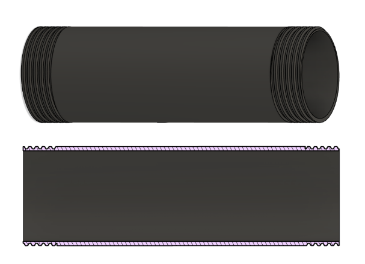
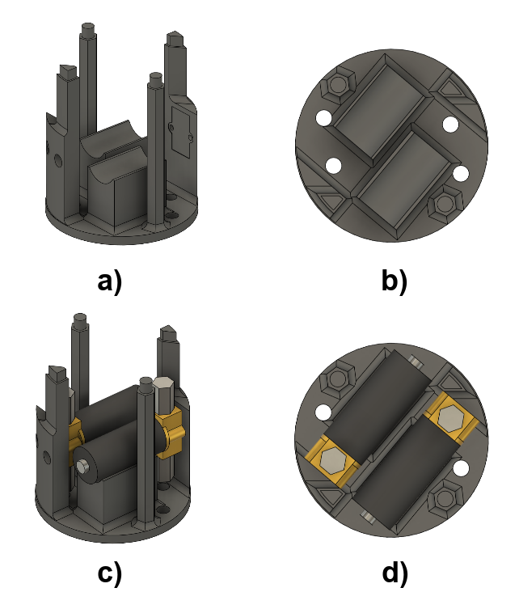
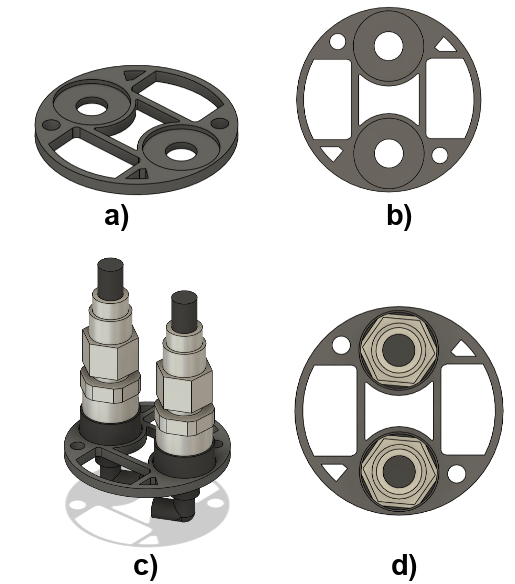
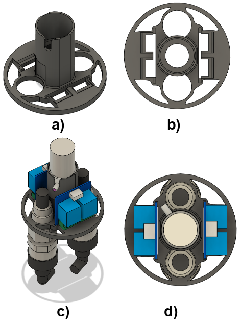
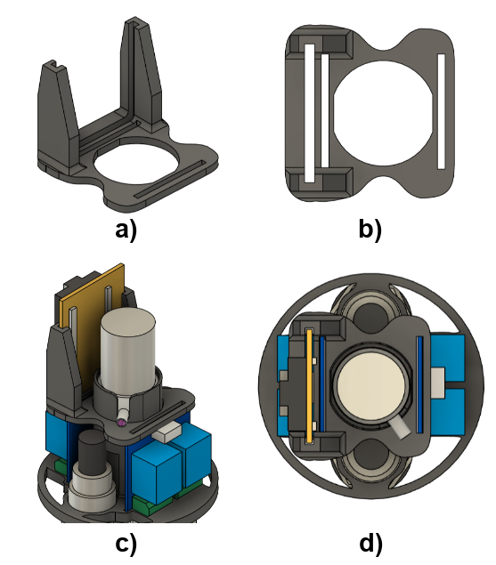
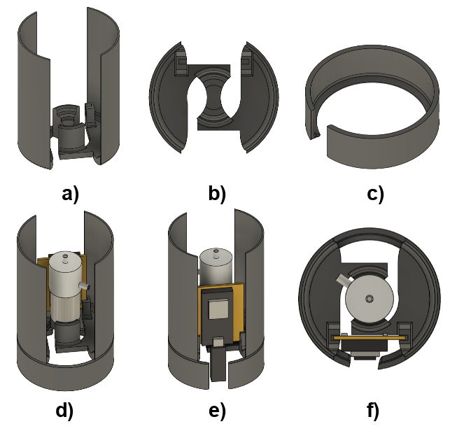
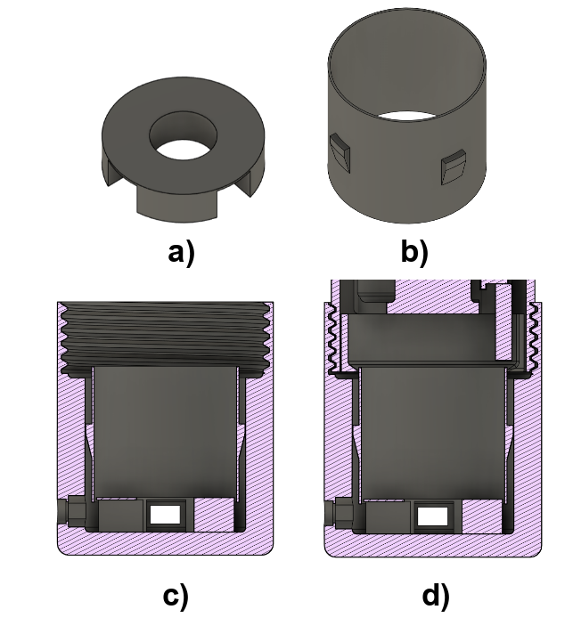
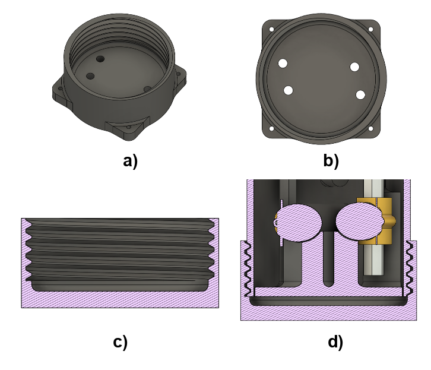
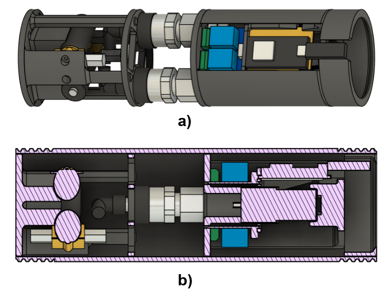
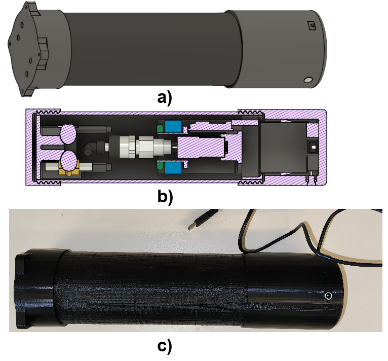

### EslabonRigidezVariable.step: 

Contiene todas las piezas necesarias para construir la "Parte Blanda" donde se realiza el "jamming". Se presentan tanto las piezas extremo como las piezas con el que montar los moldes para la silicona.

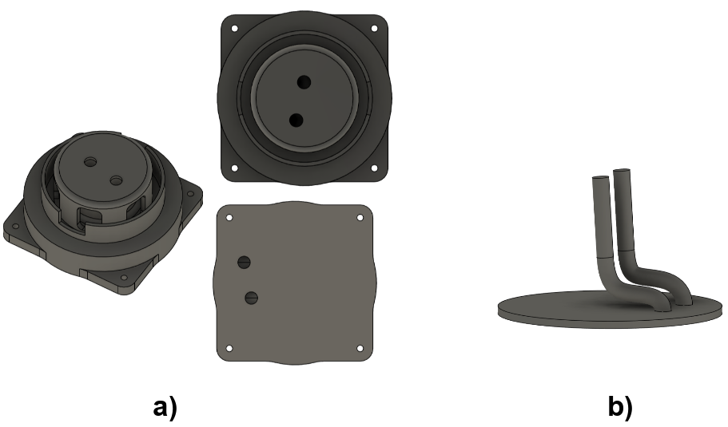
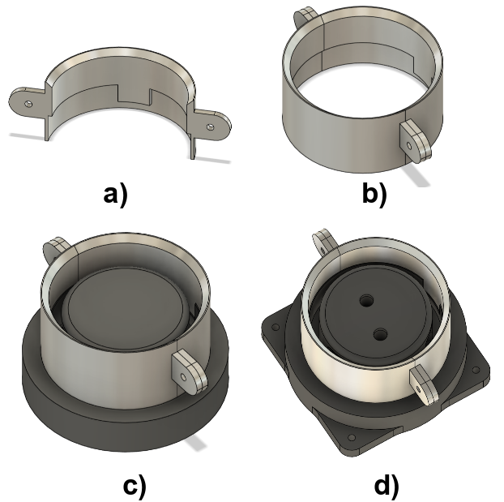
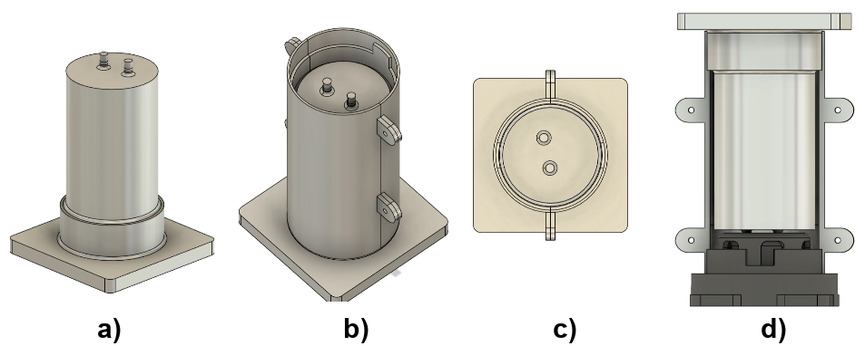
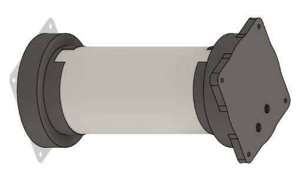

### Modelos3DComponentes.step:

Contiene los modelos 3D de los componentes electro-neumáticos que conforman el sistema del eslabón. Gracias a estos modelos se pudieron ajustar las piezas de la cámara para empaquetar lo máximo posible el sistema.

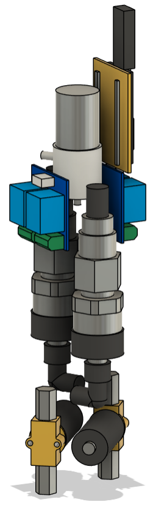

